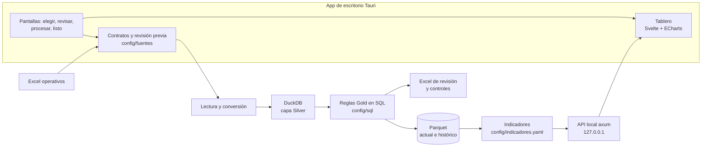

# Integrador de reportes de RR. HH.

Convierte los Excel operativos de Recursos Humanos en indicadores y en un tablero interactivo. Todo
sucede en tu PC.

[](https://github.com/Merlin2098/etl_local/actions/workflows/pruebas.yml)
[](LICENSE)

> **Prueba de concepto (POC).** El repositorio no publica instaladores ni ejecutables: quien quiera
> evaluarlo lo clona, lo compila y lo valida en su equipo (ver [Probarlo](#probarlo-con-datos-de-prueba)).
> CI solo comprueba que el código compile y que las pruebas pasen.

## El problema

En muchas áreas de RR. HH. el cierre de cada mes se arma a mano con varios Excel: la planilla (a veces
partida en varios archivos), la base de personal, las licencias, los practicantes, las altas y los
exámenes de salida. Con eso aparecen tres problemas:

- **Errores silenciosos.** Una columna movida, una hoja renombrada o un mes repetido se descubren
  tarde, cuando el indicador ya salió mal.
- **Sin trazabilidad.** Nadie puede decir de qué archivo y de qué fila salió una cifra, ni qué cambió
  respecto del mes anterior.
- **Datos fuera del equipo.** Las herramientas de BI suelen pedir subir información sensible de las
  personas a un servicio externo, o pagar licencias para verla.

Este proyecto nace de rescatar una herramienta interna en Python que resolvía parte de esto. Se rehízo
como producto abierto, sin datos reales y con un stack compilado.

## La solución

Una app de escritorio que guía el proceso en cuatro pasos:

1. **Elegir el reporte**: planilla mensual, base de personal, planilla de régimen especial, altas de
   personal, control de practicantes o control de exámenes médicos de salida.
2. **Revisar los archivos.** Antes de procesar, la app comprueba cada Excel contra un contrato
   declarativo: hojas, cabeceras, columnas, tipos y nombre de archivo. Los avisos se dan en términos de
   Excel («falta la columna X en la hoja Y»), no de programación.
3. **Procesar.** Los datos pasan por capas Silver y Gold con reglas de negocio escritas en SQL. Se
   guardan en Parquet, junto con un Excel de revisión y controles de calidad.
4. **Ver el tablero** con ocho indicadores: personas en planilla, entradas, salidas, rotación,
   ausentismo, horas extra por persona, contratos por superar su plazo y edad de jubilación. Tiene
   filtros, el detalle de las alertas por persona y descarga en CSV.

Nada sale de la PC: no hay servidor externo, cuentas ni telemetría. El tablero lo sirve una API local
de solo lectura en `127.0.0.1`.

> La app viene configurada para un caso concreto y sus Excel de ejemplo. Para usarla con tus propios
> archivos hay que adaptar la configuración: ver [Adaptarlo a tus datos](#adaptarlo-a-tus-datos).

## Arquitectura



- **Motor** (`crates/core`): contratos, lectura de Excel, DuckDB, Parquet e indicadores. No depende de
  la interfaz. Todo se puede correr desde la línea de comandos (`crates/cli`).
- **Configuración sobre código** (`config/`): un reporte nuevo es un contrato, una carpeta de SQL y una
  entrada en `reportes.yaml`, sin tocar Rust (ver [config/README.md](config/README.md)).
- **Decisiones de arquitectura**: [docs/adr/](docs/adr/README.md). Stack en
  [ADR-0001](docs/adr/0001-stack-rust-tauri.md), datos de ejemplo en
  [ADR-0002](docs/adr/0002-demo-python-uv.md), contratos en
  [ADR-0003](docs/adr/0003-formato-contrato-fuente.md), API del tablero en
  [ADR-0004](docs/adr/0004-api-local-tablero.md) e interfaz en
  [ADR-0005](docs/adr/0005-frontend-svelte-echarts.md).

## Stack

| Parte | Tecnología |
|---|---|
| Motor, CLI y API | Rust (edition 2024), DuckDB, calamine, axum |
| App de escritorio | Tauri 2 (WebView2 en Windows) |
| Interfaz y tablero | Svelte 5, Vite, TypeScript y ECharts |
| Datos de ejemplo y pruebas de paridad | Python con uv |
| CI | GitHub Actions: formato, lint y pruebas en Windows |

## Probarlo con datos de prueba

La app viene configurada para los Excel de ejemplo del repositorio. Con ellos puedes recorrer todo el
flujo sin tocar datos reales.

### 1. Clonar y compilar

Necesitas los requisitos de [Para desarrolladores](#para-desarrolladores) (Rust, Build Tools de C++,
Node.js y uv). La primera compilación tarda bastante, porque compila DuckDB desde C++.

```sh
git clone https://github.com/Merlin2098/etl_local.git
cd etl_local
npm --prefix app/ui ci
```

Luego elige una de dos formas:

- **Abrir la app sin generar un ejecutable** (la forma más rápida de validarla). Usa la configuración
  de `config/` del repositorio:

  ```sh
  npm --prefix app/ui run tauri -- dev
  ```

- **Generar el ejecutable y el instalador** de Windows:

  ```sh
  npm --prefix app/ui run tauri -- build
  ```

  El instalador queda en `target\release\bundle\nsis\` (`-setup.exe`) y en
  `target\release\bundle\msi\` (`.msi`). Instálalo para probar la app tal como la usaría alguien de
  RR. HH. Como no está firmado, no conviene distribuirlo fuera del equipo de desarrollo.

### 2. Conseguir los Excel de ejemplo

Son datos **sintéticos**: personas, documentos y montos inventados. Hay dos formas de tenerlos:

- **Los del repositorio:** la carpeta
  [crates/core/tests/fixtures/demo/limpio/](crates/core/tests/fixtures/demo/limpio/). Tiene una carpeta
  por reporte:

  | Carpeta | Reporte en la app | Archivos |
  |---|---|---|
  | `planilla/` y `planilla/licencias/` | Planilla mensual | tres meses de planilla y el control de licencias |
  | `base_personal/` | Base de personal | un corte de la base |
  | `planilla_regimen_especial/` | Planilla régimen especial | tres meses |
  | `altas_personal/` | Altas de personal | tres meses |
  | `practicantes/` | Control de practicantes | un corte |
  | `examenes_salida/` | Control de exámenes médicos de salida | un archivo |

- **Generándolos** con otra semilla o con más personas (requiere [uv](https://docs.astral.sh/uv/)):

  ```sh
  uv run --project demo generar-demo --semilla 42 --modo limpio   # queda en demo/generated/limpio/
  ```

  Las opciones están en [demo/README.md](demo/README.md).

### 3. Recorrer el flujo

1. Abre la app y elige un reporte, por ejemplo **Planilla mensual**.
2. Arrastra los Excel de su carpeta o usa **Buscar en mi computadora**. Para la planilla, los tres
   meses y el control de licencias.
3. Revisa los avisos y procesa.
4. En la pantalla final, **Ver el tablero** abre los indicadores y **Abrir en Excel** abre el Excel de
   revisión. Los resultados (Parquet, Excel de revisión y controles) quedan en
   `Documentos\Reportes RR. HH.`.
5. Repite con **Base de personal**: varios indicadores del tablero (edad de jubilación, contratos por
   superar su plazo) la necesitan.

### 4. Ver cómo avisa los errores

- [crates/core/tests/fixtures/demo/casos/](crates/core/tests/fixtures/demo/casos/) tiene un archivo
  roto por carpeta: la cabecera movida una fila, una hoja renombrada, una columna que falta o un nombre
  de archivo sin fecha. Cárgalos para ver cómo la revisión los detiene antes de procesar y dice dónde
  está el problema.
- [crates/core/tests/fixtures/demo/sucio/](crates/core/tests/fixtures/demo/sucio/) trae los mismos
  reportes con desorden realista que la app debe tolerar: documentos guardados como número, espacios
  de más en los encabezados, fechas como texto, celdas `#N/A` y filas vacías. Se procesan y dan las
  mismas cifras que los limpios.
- Los datos limpios también traen casos sembrados para que los controles tengan qué mostrar: personas de
  la planilla que no están en la base, exámenes de salida con centros de costo inexistentes,
  practicantes sin renovación y otros.

La lista completa, con lo que debe detectar cada caso, está en [demo/README.md](demo/README.md).

## Adaptarlo a tus datos

Este proyecto **no es una receta que se copia y pega**. Los contratos, las reglas y los indicadores
responden a un caso concreto de RR. HH.: los nombres de archivo, las hojas, las columnas y los umbrales
de ese caso. Tus Excel casi seguro serán distintos, y la app los rechazará en la revisión hasta que la
configuración los describa. Ese rechazo es intencional: es lo que evita indicadores calculados sobre
columnas equivocadas.

Lo que sí se reutiliza es el **molde**: revisión previa, capas Silver y Gold en SQL, Parquet, Excel de
revisión, controles y tablero. Adaptarlo se hace en [config/](config/README.md), casi siempre sin tocar
Rust:

| Si tus datos difieren en… | Se ajusta en |
|---|---|
| Nombre de archivo, hojas, fila de cabecera o nombres de columna | el contrato de la fuente, en `config/fuentes/<fuente>.yaml` (`patron_nombre`, `hojas`, `cabecera`, `origen` de cada columna) |
| Reglas de negocio: qué cuenta como salida, cómo se calcula una antigüedad | el SQL de la fuente, en `config/sql/<fuente>/` |
| Umbrales y valores fijos: días de alerta, edades, cargos | `config/parametros.yaml` |
| Indicadores del tablero | `config/indicadores.yaml` y su SQL |
| Un reporte nuevo | un contrato, una carpeta de SQL y una entrada en `config/reportes.yaml` ([guía](config/README.md)) |

Un camino razonable:

1. **Empieza por una fuente.** Toma un Excel tuyo, copia el contrato más parecido y ajusta los nombres
   de las columnas en `origen`. La revisión de la app te dirá qué falta, en términos de Excel.
2. **Revisa las reglas** de ese dominio en [docs/logica-negocio/](docs/logica-negocio/README.md). Cada
   regla tiene un ID y dice qué decisión se tomó; decide si aplica a tu caso.
3. **Compara con algo que conozcas**, por ejemplo el total de personas de un mes que ya cerraste a mano,
   antes de confiar en los indicadores.
4. **Prueba sin la interfaz** con el CLI (`etl-local validar` y `etl-local procesar`; ver [AGENTS.md](AGENTS.md)).
   Para usar tu configuración en la app instalada, apunta la variable de entorno `ETL_LOCAL_CONFIG` a tu
   carpeta `config/`.

Si tus datos no cambian de forma entre meses, la adaptación se hace una vez. Si cambian a menudo, el
contrato es el lugar donde se nota y se corrige.

## Para desarrolladores

Requisitos en Windows:

- Rust (toolchain MSVC, 1.88 o más reciente) y Build Tools de Visual Studio (C++);
- Node.js, uv y WebView2.

Notas de compilación:

- DuckDB se compila desde C++ dentro del binario. La primera compilación tarda bastante y usa mucha
  memoria.
- El archivo de paginación debe ser de 16 GB o más, o estar administrado por el sistema.
- Conviene excluir `target\` del antivirus.

| Tarea | Comando |
|---|---|
| Tests del motor, la API y el CLI | `cargo test -j 2` |
| Interfaz: dependencias, tests y build | `npm --prefix app/ui ci` · `npm --prefix app/ui test` · `npm --prefix app/ui run build` |
| App en desarrollo | `npm --prefix app/ui run tauri -- dev` |
| Ejecutable e instalador (en `target\release\bundle\`) | `npm --prefix app/ui run tauri -- build` |
| Datos de ejemplo y sus tests | `uv run --project demo generar-demo --modo limpio` · `uv run --project demo pytest demo/tests` |

La lista completa de comandos y las reglas del repositorio están en
[AGENTS.md](AGENTS.md). Ese archivo y [CLAUDE.md](CLAUDE.md) se publican a propósito: son el contrato de
trabajo para personas y agentes de IA.

Otras guías:

- la configuración: [config/README.md](config/README.md);
- las reglas de negocio con sus IDs: [docs/logica-negocio/](docs/logica-negocio/README.md);
- el resto de la documentación: [docs/](docs/README.md).

## Posibles mejoras

- **Un visualizador de datos en lugar del tablero en `localhost`**: abrir los Parquet de `gold/` en una
  herramienta de BI de escritorio o embebida, en vez del tablero propio.
- **Una web donde se consuma el tablero**: publicar los indicadores en un servidor del equipo de RR. HH.
  para verlos sin instalar la app, con autenticación.
- **Releases con instalador**: que CI compile y publique el instalador al etiquetar una versión, para que
  quien solo quiere probarlo no tenga que compilar. Requiere firma de código, para que Windows
  SmartScreen no lo bloquee.
- Instaladores para macOS y Linux. Tauri lo permite; falta probarlo.
- Llevar al tablero los reportes del molde: régimen especial, altas, practicantes y exámenes de salida.

## Licencia

[MIT](LICENSE) © 2026 Ricardo Uculmana.
