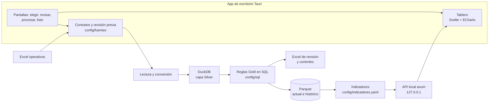

# Integrador de reportes de RR. HH.

Convierte los Excel operativos de Recursos Humanos en indicadores y en un tablero interactivo. Todo
sucede en tu PC.

[](https://github.com/merlin2098/etl-local/actions/workflows/pruebas.yml)
[](LICENSE)

**[⬇ Descargar para Windows](https://github.com/merlin2098/etl-local/releases/latest)**

## El problema

En muchas áreas de RR. HH. el cierre de cada mes se arma a mano con varios Excel: la planilla (a veces
partida en varios archivos), la base de personal, las licencias, los practicantes, las altas y los
exámenes de salida. Con eso aparecen tres problemas:

- **Errores silenciosos.** Una columna movida, una hoja renombrada o un mes repetido se descubren
  tarde, cuando el indicador ya salió mal.
- **Sin trazabilidad.** Nadie puede decir de qué archivo y de qué fila salió una cifra, ni qué cambió
  respecto del mes anterior.
- **Datos fuera del equipo.** Las herramientas de BI suelen pedir subir información sensible de las
  personas a un servicio externo, o pagar licencias para verla.

Este proyecto nace de rescatar una herramienta interna en Python que resolvía parte de esto. Se rehízo
como producto abierto, sin datos reales y con un stack compilado.

## La solución

Una app de escritorio que guía el proceso en cuatro pasos:

1. **Elegir el reporte**: planilla mensual, base de personal, planilla de régimen especial, altas de
   personal, control de practicantes o control de exámenes médicos de salida.
2. **Revisar los archivos.** Antes de procesar, la app comprueba cada Excel contra un contrato
   declarativo: hojas, cabeceras, columnas, tipos y nombre de archivo. Los avisos se dan en términos de
   Excel («falta la columna X en la hoja Y»), no de programación.
3. **Procesar.** Los datos pasan por capas Silver y Gold con reglas de negocio escritas en SQL. Se
   guardan en Parquet, junto con un Excel de revisión y controles de calidad.
4. **Ver el tablero** con ocho indicadores: personas en planilla, entradas, salidas, rotación,
   ausentismo, horas extra por persona, contratos por superar su plazo y edad de jubilación. Tiene
   filtros, el detalle de las alertas por persona y descarga en CSV.

Nada sale de la PC: no hay servidor externo, cuentas ni telemetría. El tablero lo sirve una API local
de solo lectura en `127.0.0.1`.

## Arquitectura



- **Motor** (`crates/core`): contratos, lectura de Excel, DuckDB, Parquet e indicadores. No depende de
  la interfaz. Todo se puede correr desde la línea de comandos (`crates/cli`).
- **Configuración sobre código** (`config/`): un reporte nuevo es un contrato, una carpeta de SQL y una
  entrada en `reportes.yaml`, sin tocar Rust (ver [config/README.md](config/README.md)).
- **Decisiones de arquitectura**: [docs/adr/](docs/adr/README.md). Stack en
  [ADR-0001](docs/adr/0001-stack-rust-tauri.md), datos de ejemplo en
  [ADR-0002](docs/adr/0002-demo-python-uv.md), contratos en
  [ADR-0003](docs/adr/0003-formato-contrato-fuente.md), API del tablero en
  [ADR-0004](docs/adr/0004-api-local-tablero.md) e interfaz en
  [ADR-0005](docs/adr/0005-frontend-svelte-echarts.md).

## Stack

| Parte | Tecnología |
|---|---|
| Motor, CLI y API | Rust (edition 2024), DuckDB, calamine, axum |
| App de escritorio | Tauri 2 (WebView2 en Windows) |
| Interfaz y tablero | Svelte 5, Vite, TypeScript y ECharts |
| Datos de ejemplo y pruebas de paridad | Python con uv |
| CI y releases | GitHub Actions con `tauri-apps/tauri-action` |

## Probarlo

1. Descarga el instalador (`.msi` o `-setup.exe`) del
   [último release](https://github.com/merlin2098/etl-local/releases/latest).
2. El instalador no está firmado, así que Windows SmartScreen puede mostrar «Windows protegió su PC».
   Elige **Más información → Ejecutar de todas formas**.
3. Para tener Excel de ejemplo, usa los que vienen en el repositorio,
   [crates/core/tests/fixtures/demo/limpio/](crates/core/tests/fixtures/demo/limpio/), o genera los tuyos:

   ```sh
   uv run --project demo generar-demo --semilla 42 --modo limpio
   ```

   Son datos **sintéticos**: personas, documentos y montos inventados. El modo `sucio` y los casos de
   [demo/README.md](demo/README.md) traen errores a propósito, para ver los avisos de la revisión.

## Para desarrolladores

Requisitos en Windows:

- Rust (toolchain MSVC, 1.88 o más reciente) y Build Tools de Visual Studio (C++);
- Node.js, uv y WebView2.

Notas de compilación:

- DuckDB se compila desde C++ dentro del binario. La primera compilación tarda bastante y usa mucha
  memoria.
- El archivo de paginación debe ser de 16 GB o más, o estar administrado por el sistema.
- Conviene excluir `target\` del antivirus.

| Tarea | Comando |
|---|---|
| Tests del motor, la API y el CLI | `cargo test -j 2` |
| Interfaz: dependencias, tests y build | `npm --prefix app/ui ci` · `npm --prefix app/ui test` · `npm --prefix app/ui run build` |
| App en desarrollo | `npm --prefix app/ui run tauri -- dev` |
| Instalador | `npm --prefix app/ui run tauri -- build` |
| Datos de ejemplo y sus tests | `uv run --project demo generar-demo --modo limpio` · `uv run --project demo pytest demo/tests` |

La lista completa de comandos, las reglas del repositorio y cómo se publica un release están en
[AGENTS.md](AGENTS.md). Ese archivo y [CLAUDE.md](CLAUDE.md) se publican a propósito: son el contrato de
trabajo para personas y agentes de IA.

Otras guías:

- la configuración: [config/README.md](config/README.md);
- las reglas de negocio con sus IDs: [docs/logica-negocio/](docs/logica-negocio/README.md);
- el resto de la documentación: [docs/](docs/README.md).

## Posibles mejoras

- **Un visualizador de datos en lugar del tablero en `localhost`**: abrir los Parquet de `gold/` en una
  herramienta de BI de escritorio o embebida, en vez del tablero propio.
- **Una web donde se consuma el tablero**: publicar los indicadores en un servidor del equipo de RR. HH.
  para verlos sin instalar la app, con autenticación.
- Instaladores para macOS y Linux. Tauri lo permite; falta probarlo en CI.
- Firma de código del instalador, para que SmartScreen no muestre el aviso.
- Llevar al tablero los reportes del molde: régimen especial, altas, practicantes y exámenes de salida.

## Licencia

[MIT](LICENSE) © 2026 Ricardo Uculmana.
